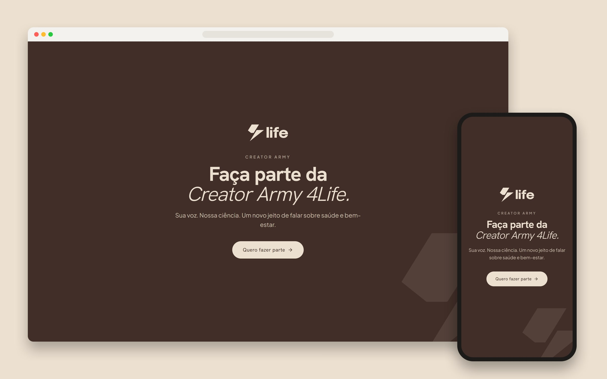
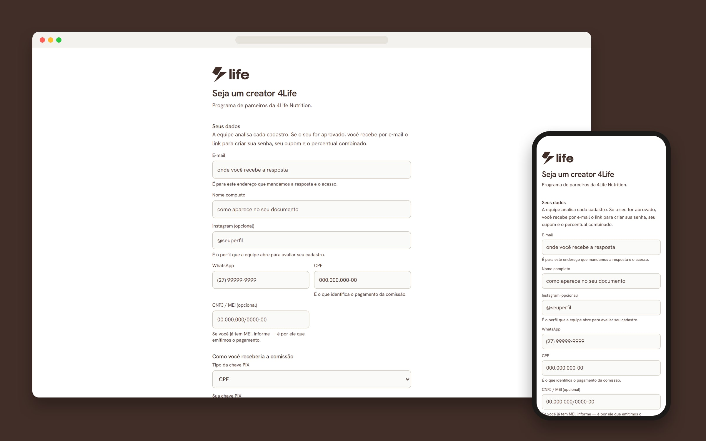
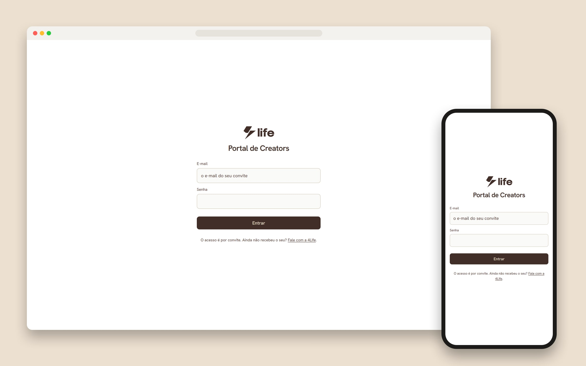
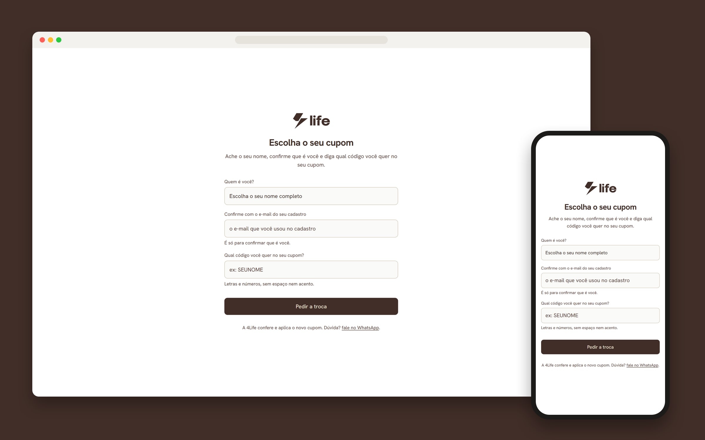
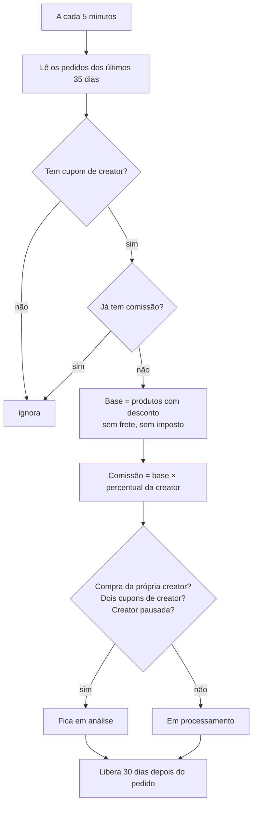
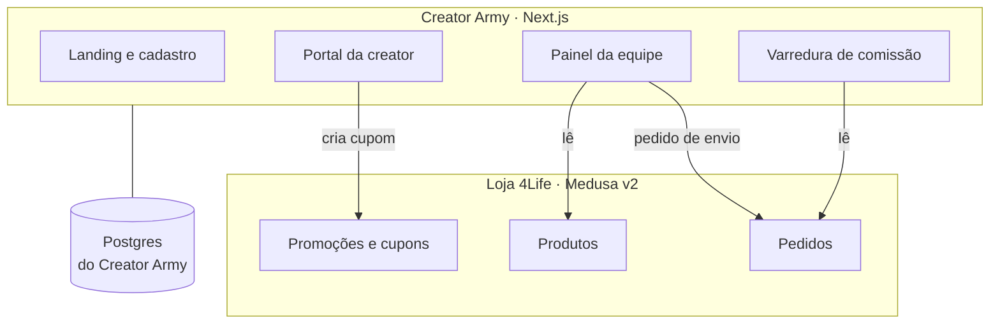

# 4Life Creators: plataforma de influenciadores

O Creator Army é o programa de parceiros da 4Life Nutrition para influenciadores e criadores de conteúdo. A plataforma cuida de tudo, do recrutamento ao pagamento: aprova quem entra, dá um cupom para cada creator, apura a comissão de cada venda e organiza as campanhas de produto. Está no ar em [4lifenutrition.com.br/creator-army](https://4lifenutrition.com.br/creator-army).

> Repositório vitrine, publicado com autorização do cliente. O código é da 4Life e fica num repositório privado.

Sou o desenvolvedor responsável pela plataforma, do motor de comissão às telas da creator e da equipe. Também fui eu que decidi separá-la da loja, como conto no fim.

## Telas

Todos os prints são de produção e só mostram páginas públicas. O portal logado e o painel da equipe têm dados de creators reais e ficaram de fora.

**Cadastro.** Formulário público, com cada ficha avaliada por uma pessoa da equipe antes de alguém ganhar acesso.

| Entrada do portal (só por convite) | A creator escolhe o código do cupom |
|---|---|
|  |  |

## Como funciona

1. A landing do Creator Army apresenta o programa e leva ao cadastro. Ela nasceu para recrutar creators num evento presencial e depois virou página de campanha.
2. A creator preenche o formulário público e a ficha cai numa fila no painel. A equipe aprova ou recusa. Ficha que ninguém avalia é apagada em 7 dias, porque ela guarda CPF, endereço e chave Pix de quem ainda não é parceira.
3. Quem é aprovada recebe por e-mail um link que vale 7 dias e só para o e-mail convidado. No convite ela cria a senha e preenche os dados, o endereço e a chave Pix, validada no servidor.
4. No primeiro acesso, a creator cria o próprio cupom. O sistema sugere um código a partir do Instagram ou do nome e confere contra todos os cupons da loja. Para trocar depois, ela pede e a equipe aprova. As vendas do cupom antigo continuam contando para ela.
5. O cupom é uma promoção nativa da loja, então o checkout não precisa de nenhum caminho especial. A venda conta para a creator pelo cupom do pedido, sem cookie nem pixel.
6. O portal foi feito para o celular, com quatro abas: Início, Extrato, Campanhas e Meus dados.
7. Nas campanhas de produto, a equipe define produto, regras, referências, período e número de vagas. A creator escolhe o sabor, confirma o endereço e se inscreve. Cada participação aprovada vira um pedido de envio com valor zero dentro da loja, sem disparar os e-mails de compra.
8. No painel, a equipe tem a fila de cadastros, a ficha de cada creator, as trocas de cupom, as campanhas, o registro de pagamentos e a exportação da lista de contato em CSV.

## A comissão

Foi a parte que mais exigiu cuidado, porque é onde um erro vira dinheiro errado no bolso de alguém. A apuração é uma varredura, não um ouvinte de evento: não existe evento para perder nem para chegar duas vezes.

A comissão só nasce quando o dinheiro entra. Pix e boleto compensam depois do pedido, e a varredura espera por isso. Se ela ficar parada por um deploy ou uma fila fora do ar, a passada seguinte recupera o que faltou. Um índice único por pedido impede comissão em dobro.

A base é o valor dos produtos já com o desconto do cupom, sem frete e sem imposto, calculada em centavos inteiros. A comissão fica em processamento durante os 30 dias da janela de devolução e só então passa a "a receber".

Pedido cancelado ou estornado anula a comissão. Se ela já tinha sido paga, o acerto aparece no extrato e sai do próximo pagamento. Venda suspeita (o e-mail ou o CPF do comprador são os da creator, dois cupons de creator no mesmo pedido, creator pausada) não é bloqueada. Ela fica em análise e uma pessoa decide.

O Pix é feito pela 4Life. A equipe registra o pagamento no painel, só entram comissões que já estão a receber, e no extrato da creator elas passam a "paga".

## Portal da creator

O Início foi desenhado em cima de uma regra: abrir no celular e saber em 3 segundos quanto tem a receber, quando libera e qual é o cupom. O saldo a receber fica em destaque, o cupom tem botão de copiar, e logo abaixo vêm os saldos em processamento, já recebido e em análise, o desempenho e as últimas vendas. No primeiro acesso, em vez de um "R$ 0,00" desanimador, a tela dá boas-vindas e mostra o próximo passo.

O Extrato lista cada venda e cada pagamento, com filtro de período, e não mostra nenhum dado de quem comprou. Campanhas traz as campanhas abertas com regras e referências, e Meus dados guarda cadastro, endereço, chave Pix e cupom.

## Painel da equipe

Os cargos negam por padrão: a gestão de creators vê só a área de creators, e o administrador vê tudo. A exportação em CSV traz contato e endereço, e deixa de fora chave Pix, comissão, cupom e valores. Um botão "Apurar agora" roda a varredura na hora, sem esperar os 5 minutos.

## Segurança

Cada entrega passou por revisão adversarial, e o portal teve um teste de intrusão em produção. A revisão pegou dois problemas antes de irem ao ar. O primeiro: qualquer pessoa com o link do convite conseguia gravar a própria chave Pix na conta de outra creator. O segundo: dava para inscrever alguém com o e-mail dela e a chave Pix de outra pessoa. Hoje o convite só vale para o e-mail convidado, e a chave aparece na tela para a creator conferir.

## Arquitetura

O programa nasceu como um módulo do backend Medusa v2 da loja, com o portal dentro do storefront Next.js. A comissão lia os pedidos direto no mesmo Postgres.

Em dois meses ele cresceu para um produto à parte, com cerca de 2.700 linhas de módulo, 26 rotas e 13 telas. Todo deploy do programa era um deploy da loja, e vice-versa. Em outubro de 2026 decidi separar os dois, e a migração está em andamento.

O app novo tem repositório, banco, login e deploy próprios, e nunca abre conexão com o banco da loja. Ele fala só pela API admin do Medusa, com uma chave dedicada e restrita, do lado da loja, a uma lista fechada de 7 rotas.

A varredura muda só a fonte, da consulta direta para a API, e continua idempotente. Foi isso que tornou a separação segura: não há fila de eventos para manter sincronizada. A troca roda em sombra: o app novo recalcula toda comissão ao lado do antigo, e um relatório diário compara pedido a pedido. O corte só acontece depois de 7 dias sem nenhuma diferença, e até lá qualquer passo pode ser desfeito.

## Stack

Next.js (App Router) · React · TypeScript · Tailwind CSS · Medusa v2 · PostgreSQL · Resend · Docker · Traefik · GitHub Actions

## Outros cases

- [Kamo](https://github.com/Dowgg18/kamo-showcase): meu SaaS de IA no WhatsApp para concessionárias, com 30 mil mensagens em produção.
- [E-commerce da 4Life Nutrition](https://github.com/Dowgg18/4life-nutrition-showcase): loja com código próprio, do checkout à nota fiscal.
- [Câmara Brasil-Rússia](https://github.com/Dowgg18/camara-brasil-russia-showcase): portal em português, russo e inglês com redação assistida por IA.

---

Douglas Domingos · [github.com/Dowgg18](https://github.com/Dowgg18) · [LinkedIn](https://www.linkedin.com/in/douglas-c-domingos/)
