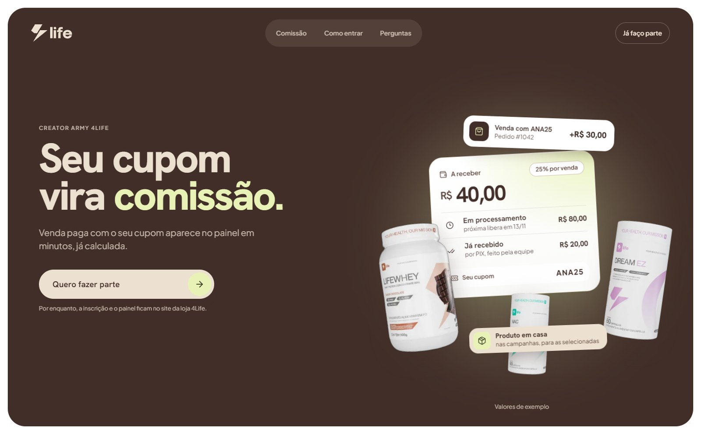
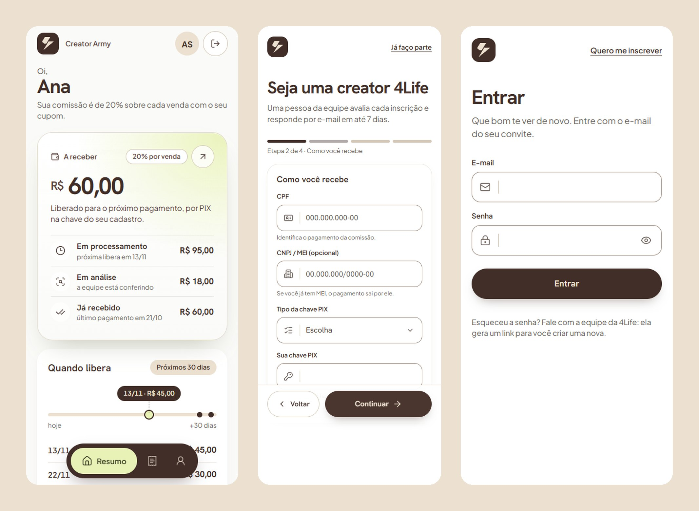
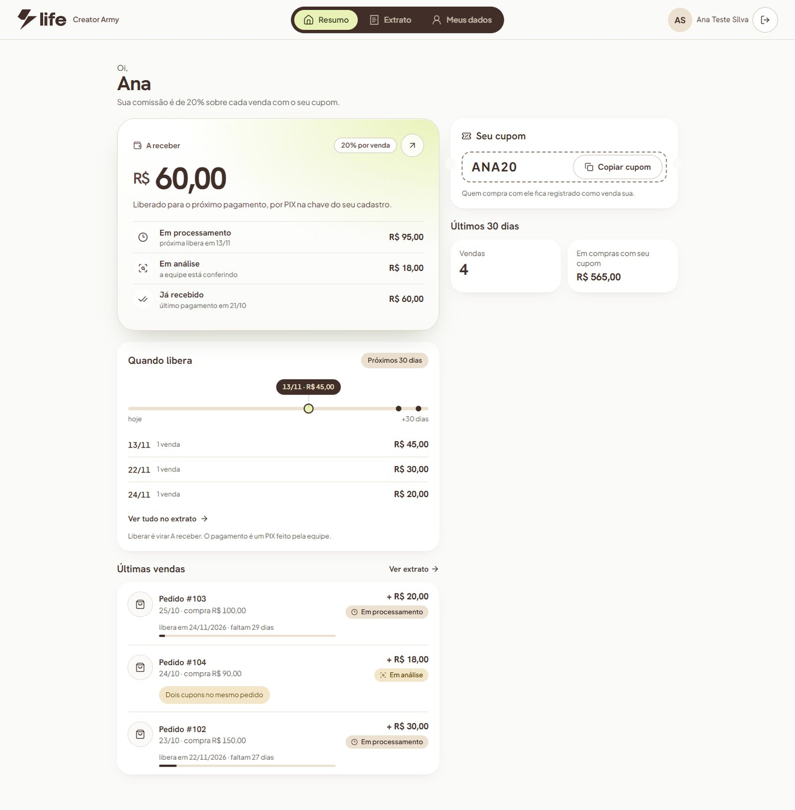
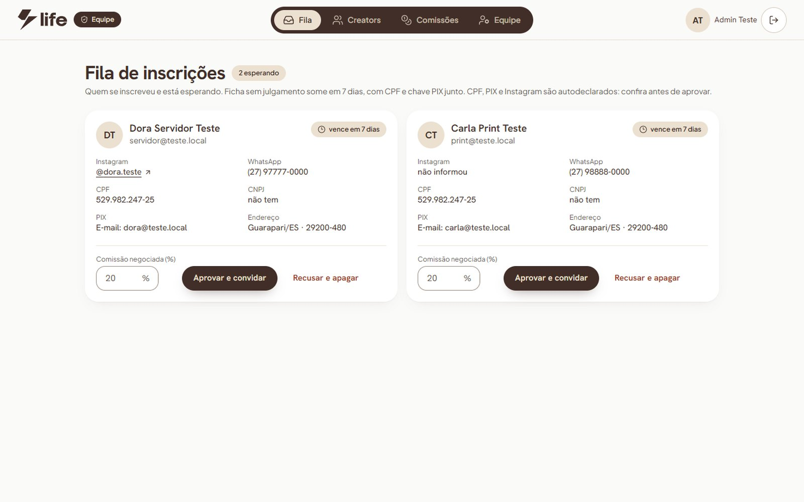
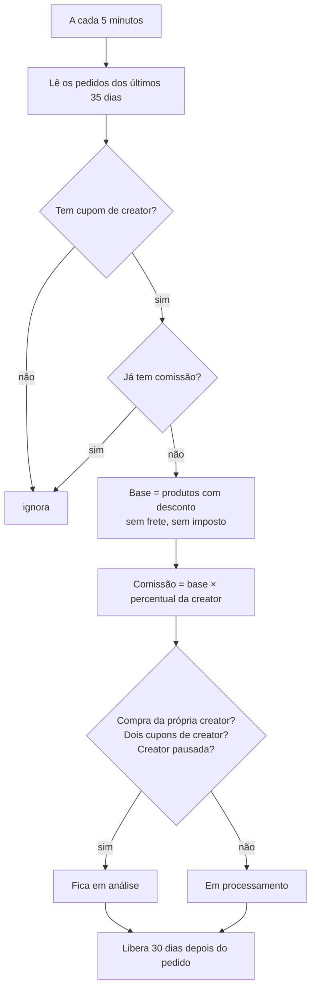
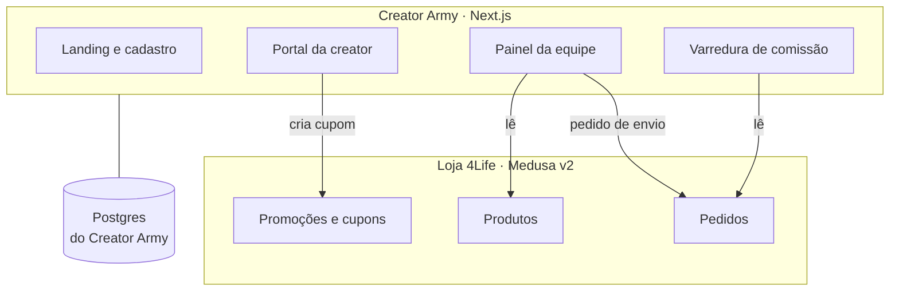

# 4Life Creators: plataforma de influenciadores

O Creator Army é o programa de parceiros da 4Life Nutrition para influenciadores e criadores de conteúdo. A plataforma cuida de tudo, do recrutamento ao pagamento: aprova quem entra, dá um cupom para cada creator, apura a comissão de cada venda e organiza as campanhas de produto. Desde outubro de 2026 ela tem domínio, banco, login e deploy próprios, em [creator.4lifenutrition.com.br](https://creator.4lifenutrition.com.br).

> Repositório vitrine, publicado com autorização do cliente. O código é da 4Life e fica num repositório privado.

Sou o desenvolvedor responsável pela plataforma, do motor de comissão às telas da creator e da equipe. Também fui eu que decidi separá-la da loja, como conto no fim.

## Telas

As telas da plataforma aparecem com dados de demonstração. O portal e o painel de verdade têm dados de creators reais e não entram aqui.

**Landing.** Feita primeiro para o celular, porque quase todo mundo chega pelo Instagram. Cada tela tem uma ideia só: o cupom que vira comissão, o caminho de uma venda até o painel e o produto que chega em casa nas campanhas. A versão anterior ocupava 15 telas de altura no celular; esta cabe em 7.

**Portal da creator, cadastro e entrada.** O resumo responde em 3 segundos quanto há a receber, quando libera e o que está em análise. O cadastro virou quatro etapas curtas, e o login segue o padrão de app, com ícone em cada campo e botão escuro.

| Resumo no desktop | Fila da equipe |
|---|---|
|  |  |

## Como funciona

1. A landing apresenta o programa e leva ao cadastro.
2. A creator preenche o formulário público e a ficha cai numa fila no painel. A equipe aprova, com o percentual combinado, ou recusa. Ficha que ninguém avalia é apagada em 7 dias, porque ela guarda CPF, endereço e chave Pix de quem ainda não é parceira.
3. Quem é aprovada recebe por e-mail um link que vale 7 dias e só funciona uma vez. Antes de criar a senha, ela confere a chave Pix que vai receber a comissão.
4. A creator ganha um cupom só dela, conferido contra todos os cupons da loja. O cupom é uma promoção nativa da loja, então o checkout não precisa de nenhum caminho especial. A venda conta para a creator pelo cupom do pedido, sem cookie nem pixel.
5. Nas campanhas de produto, a equipe define produto, regras, período e número de vagas. A creator escolhe a variação, confirma o endereço e se inscreve. Cada participação aprovada vira um pedido de envio com valor zero dentro da loja, sem disparar os e-mails de compra.
6. No painel, a equipe tem a fila de cadastros, a ficha de cada creator, as comissões em análise, os membros da equipe e o registro de pagamentos.

## A comissão

Foi a parte que mais exigiu cuidado, porque é onde um erro vira dinheiro errado no bolso de alguém. A apuração é uma varredura, não um ouvinte de evento: não existe evento para perder nem para chegar duas vezes.

A comissão só nasce quando o dinheiro entra. Pix e boleto compensam depois do pedido, e a varredura espera por isso. Se ela ficar parada por um deploy ou uma fila fora do ar, a passada seguinte recupera o que faltou. Um índice único por pedido impede comissão em dobro.

A base é o valor dos produtos já com o desconto do cupom, sem frete e sem imposto, calculada em centavos inteiros. A comissão fica em processamento durante os 30 dias da janela de devolução e só então passa a "a receber". O status nunca é gravado: ele é derivado na hora da leitura, então não existe job que precise virar "processamento" em "a receber" e possa falhar.

Pedido cancelado ou estornado anula a comissão. Se ela já tinha sido paga, o acerto aparece no extrato e sai do próximo pagamento. Venda suspeita não é bloqueada: ela fica em análise e uma pessoa decide.

## Design: da referência ao sistema

O dono do projeto mandou uma referência de app de creators: cartão de saldo grande com brilho, navegação em pílula escura, login limpo. A pedido dele, três propostas independentes traduziram a referência para a identidade da 4Life por ângulos diferentes (fiel à referência, orgânica da marca e clareza do dinheiro), e uma avaliação comparou as três antes de virar uma especificação única.

Venceu a clareza do dinheiro, com enxertos das outras duas. A peça que melhor mostra a escolha é a régua "Quando libera": onde a referência tinha um gráfico de engajamento, o portal mostra a data e o valor de cada liberação dos próximos 30 dias. É a pergunta que a creator faz de verdade. "Em análise" fica fora da régua, porque não tem data. O lima da marca é usado só no que é da creator, numa lista fechada de lugares, e todas as combinações de cor foram medidas para passar no contraste AA.

## Segurança

Cada entrega passou por revisão adversarial, e o portal teve um teste de intrusão em produção. A revisão pegou problemas antes de irem ao ar, como um convite que deixava gravar a chave Pix na conta de outra pessoa. Hoje o convite só vale para o e-mail convidado, e a chave aparece na tela para a creator conferir.

Na plataforma nova, a senha é guardada com scrypt, a sessão vive no banco e só o hash do token fica gravado. O login responde igual para e-mail inexistente e senha errada, tem limite de tentativas, e pausar uma creator derruba a sessão dela na hora. As telas da equipe conferem a sessão antes de qualquer consulta ao banco.

## Arquitetura

O programa nasceu como um módulo do backend Medusa v2 da loja, com o portal dentro do storefront Next.js. Em dois meses cresceu para um produto à parte, e todo deploy do programa era um deploy da loja. Em outubro de 2026 decidi separar os dois.

O app novo tem repositório, banco, login e deploy próprios, e nunca abre conexão com o banco da loja. Ele fala com a loja só pela API admin do Medusa, numa lista fechada de 7 rotas: o próprio cliente da API recusa qualquer chamada fora dela, e a chave dedicada da integração nasce restrita a essas rotas. O deploy também é separado: um usuário próprio no servidor que só consegue rodar o script de deploy do programa, com volta automática para a versão anterior se a verificação de saúde falhar.

**Onde a migração está.** A landing nova já roda no domínio próprio. O cadastro, o portal e o painel da equipe estão prontos e testados de ponta a ponta, atrás de uma chave que mantém tudo fechado até o corte. As creators de verdade continuam no portal antigo até lá. A varredura muda só a fonte, da consulta direta para a API, e continua idempotente. Antes do corte ela roda em sombra, recalculando toda comissão ao lado da antiga, e a troca só acontece depois de 7 dias sem nenhuma diferença.

## Stack

Next.js (App Router) · React · TypeScript · Tailwind CSS · Drizzle · PostgreSQL · Medusa v2 · Resend · Docker · Traefik · GitHub Actions · Playwright

## Outros cases

- [Kamo](https://github.com/Dowgg18/kamo-showcase): meu SaaS de IA no WhatsApp para concessionárias, com 30 mil mensagens em produção.
- [E-commerce da 4Life Nutrition](https://github.com/Dowgg18/4life-nutrition-showcase): loja com código próprio, do checkout à nota fiscal.
- [Câmara Brasil-Rússia](https://github.com/Dowgg18/camara-brasil-russia-showcase): portal em português, russo e inglês com redação assistida por IA.

---

Douglas Domingos · [github.com/Dowgg18](https://github.com/Dowgg18) · [LinkedIn](https://www.linkedin.com/in/douglas-c-domingos/)
